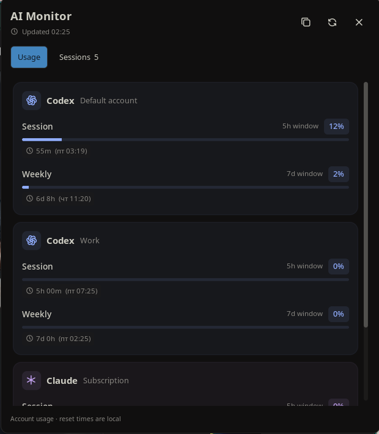
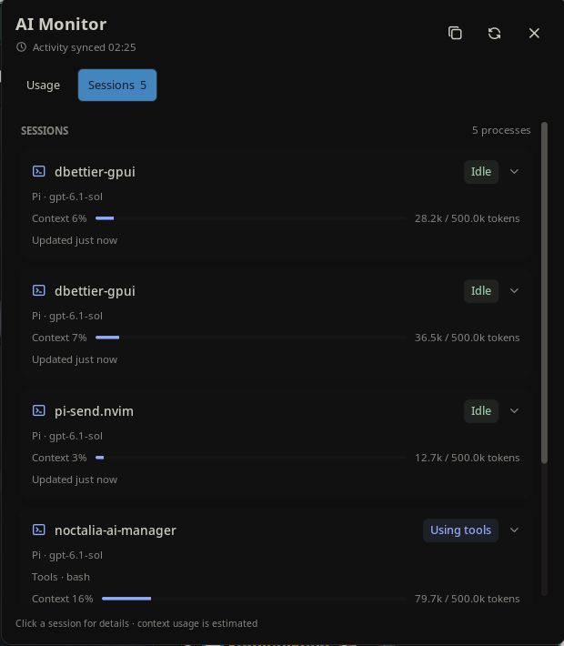

# Noctalia AI Monitor

Monitor Pi and Claude Code from your Noctalia bar.

- Live session activity: working, using tools, waiting for input, or idle.
- Codex and Claude subscription usage, weekly warnings, and reset countdowns.
- Pi context usage and separate usage meters for different accounts.

Click a usage meter or activity badge to open the details panel.


<details>
<summary>Usage and session panels</summary>





</details>

## Requirements

Linux, Noctalia v5 (plugin API 24+), Node.js 22+, npm, and Pi and/or Claude Code.
No npm dependencies are needed.

## Install

```sh
git clone https://github.com/SavingFrame/noctalia-ai-monitor.git ~/.local/share/noctalia-ai-monitor
cd ~/.local/share/noctalia-ai-monitor
noctalia msg plugins source add ai-monitor-dev path "$PWD"
noctalia msg plugins enable archie/ai-monitor
npm run install:integrations
```

Add **AI Monitor / Sessions** from Noctalia's bar settings.

Run `/reload` in Pi and restart Claude Code. Keep the checkout in place:
the plugin and integrations reference its location.

The integration installer configures both Pi and Claude Code, preserving existing
hooks and backing up Claude's settings. Skip it if you only need usage meters
and basic process detection.

## Update

From the checkout:

```sh
git pull --ff-only
npm run install:integrations
```

Reload Pi and restart Claude Code afterward.

## Privacy and limitations

Activity stays local. Prompts, conversations, tool arguments, and results are
not collected. Quota requests use your existing local OAuth credentials and go
only to the corresponding provider. Tokens are never shown in the widget,
logged, or refreshed by this plugin.

Quota polling runs every 5 minutes and can be disabled in plugin settings.
It requires a Pi Codex OAuth login or a Claude Code subscription login.
Provider usage endpoints are undocumented and may change. Missing or expired
logins show unavailable rather than zero.

## Uninstall

Remove the widget, disable `archie/ai-monitor`, and remove its plugin source.
Remove `~/.pi/agent/extensions/noctalia-ai-monitor` and only the Claude hooks
referencing this checkout's `claude-hook.mjs`. Reload Pi and restart Claude Code
before deleting the checkout.

[Technical details and diagnostics](docs/DETAILS.md) · [MIT license](LICENSE) ·
[Third-party notices](ai-monitor/THIRD_PARTY_NOTICES.md)
